# One More Rep — Database ERD

## 1. Overview

One More Rep is a fitness platform consisting of:
- Flutter trainee mobile application
- Laravel REST API
- Coach dashboard
- Super Admin dashboard
- PostgreSQL database

The database must support role-based access, coach-trainee relationships, workout tracking, subscriptions, manual payment verification, vouchers, and future AI features.

## 2. Core Design Decisions

- A user can have multiple roles.
- A trainee has one primary coach at a time.
- The schema supports additional secondary coaches.
- The Super Admin controls coach platform subscription plans and pricing.
- Subscription records preserve the price and duration agreed at purchase time.
- Manual payment requests require server-side verification.
- Vouchers are validated and redeemed by the backend.
- Every coach-owned resource must be protected against cross-coach access.
- Sensitive configuration and credentials must never be stored in source control.

## 3. ERD

```mermaid
erDiagram
    USERS ||--o{ USER_ROLES : has
    ROLES ||--o{ USER_ROLES : assigned
    USERS ||--o| COACH_PROFILES : has
    USERS ||--o| TRAINEE_PROFILES : has

    USERS ||--o{ COACH_TRAINEE_RELATIONSHIPS : coach
    USERS ||--o{ COACH_TRAINEE_RELATIONSHIPS : trainee

    USERS ||--o{ SUBSCRIPTIONS : owns
    SUBSCRIPTION_PLANS ||--o{ SUBSCRIPTIONS : selected
    USERS ||--o{ SUBSCRIPTION_PLANS : creates

    VOUCHERS ||--o{ VOUCHER_REDEMPTIONS : redeemed
    USERS ||--o{ VOUCHER_REDEMPTIONS : redeems
    SUBSCRIPTIONS ||--o{ VOUCHER_REDEMPTIONS : applies

    USERS ||--o{ PAYMENT_REQUESTS : submits
    SUBSCRIPTIONS ||--o{ PAYMENT_REQUESTS : pays_for
    PAYMENT_REQUESTS ||--o{ PAYMENT_TRANSACTIONS : records

    USERS ||--o{ EXERCISES : creates
    USERS ||--o{ WORKOUT_PROGRAMS : creates
    WORKOUT_PROGRAMS ||--o{ WORKOUT_PROGRAM_DAYS : contains
    WORKOUT_PROGRAM_DAYS ||--o{ WORKOUT_DAY_EXERCISES : contains
    EXERCISES ||--o{ WORKOUT_DAY_EXERCISES : references

    WORKOUT_PROGRAMS ||--o{ WORKOUT_ASSIGNMENTS : assigned
    USERS ||--o{ WORKOUT_ASSIGNMENTS : trainee
    USERS ||--o{ WORKOUT_ASSIGNMENTS : assigned_by

    WORKOUT_ASSIGNMENTS ||--o{ WORKOUT_SESSIONS : tracks
    WORKOUT_SESSIONS ||--o{ WORKOUT_SETS : contains
    EXERCISES ||--o{ WORKOUT_SETS : performed

    USERS ||--o{ CARDIO_SESSIONS : records
    USERS ||--o{ BODY_MEASUREMENTS : records
    USERS ||--o{ AUDIT_LOGS : performs

    USERS {
        bigint id PK
        string name
        string email UK
        string password
        timestamp email_verified_at
        timestamp created_at
        timestamp updated_at
    }

    ROLES {
        bigint id PK
        string name UK
    }

    USER_ROLES {
        bigint user_id PK, FK
        bigint role_id PK, FK
    }

    COACH_PROFILES {
        bigint id PK
        bigint user_id FK, UK
        string display_name
        text bio
        boolean is_active
    }

    TRAINEE_PROFILES {
        bigint id PK
        bigint user_id FK, UK
        date date_of_birth
        string sex
        decimal height_cm
        decimal initial_weight_kg
    }

    COACH_TRAINEE_RELATIONSHIPS {
        bigint id PK
        bigint coach_id FK
        bigint trainee_id FK
        string relationship_type
        string status
        timestamp started_at
        timestamp responded_at
        timestamp ended_at
    }

    SUBSCRIPTION_PLANS {
        bigint id PK
        bigint created_by FK
        string audience
        string name
        decimal price
        string currency
        integer duration_days
        boolean is_active
    }

    SUBSCRIPTIONS {
        bigint id PK
        bigint user_id FK
        bigint plan_id FK
        string status
        decimal price_snapshot
        string currency_snapshot
        integer duration_days_snapshot
        timestamp starts_at
        timestamp ends_at
    }

    VOUCHERS {
        bigint id PK
        string code UK
        string discount_type
        decimal discount_value
        integer max_redemptions
        timestamp starts_at
        timestamp expires_at
        boolean is_active
    }

    VOUCHER_REDEMPTIONS {
        bigint id PK
        bigint voucher_id FK
        bigint user_id FK
        bigint subscription_id FK
        decimal discount_amount
        timestamp redeemed_at
    }

    PAYMENT_REQUESTS {
        bigint id PK
        bigint user_id FK
        bigint subscription_id FK
        decimal amount
        string currency
        string method
        string payment_reference
        string status
        bigint reviewed_by FK
        timestamp reviewed_at
    }

    PAYMENT_TRANSACTIONS {
        bigint id PK
        bigint payment_request_id FK
        string transaction_type
        string provider_reference
        decimal amount
        string status
        timestamp created_at
    }

    EXERCISES {
        bigint id PK
        bigint created_by FK
        string name
        string muscle_group
        string equipment
        text instructions
        boolean is_public
    }

    WORKOUT_PROGRAMS {
        bigint id PK
        bigint coach_id FK
        string name
        text description
        boolean is_active
    }

    WORKOUT_PROGRAM_DAYS {
        bigint id PK
        bigint workout_program_id FK
        integer day_number
        string name
    }

    WORKOUT_DAY_EXERCISES {
        bigint id PK
        bigint workout_program_day_id FK
        bigint exercise_id FK
        integer sort_order
        integer target_sets
        integer target_reps_min
        integer target_reps_max
        decimal target_weight_kg
        integer rest_seconds
    }

    WORKOUT_ASSIGNMENTS {
        bigint id PK
        bigint workout_program_id FK
        bigint trainee_id FK
        bigint assigned_by FK
        date starts_on
        date ends_on
        string status
    }

    WORKOUT_SESSIONS {
        bigint id PK
        bigint workout_assignment_id FK
        bigint trainee_id FK
        timestamp started_at
        timestamp completed_at
        text notes
    }

    WORKOUT_SETS {
        bigint id PK
        bigint workout_session_id FK
        bigint exercise_id FK
        integer set_number
        decimal weight_kg
        integer reps
        boolean is_completed
    }

    CARDIO_SESSIONS {
        bigint id PK
        bigint trainee_id FK
        string activity_type
        integer duration_seconds
        decimal distance_km
        integer average_heart_rate
        timestamp performed_at
    }

    BODY_MEASUREMENTS {
        bigint id PK
        bigint trainee_id FK
        decimal weight_kg
        decimal body_fat_percentage
        decimal waist_cm
        decimal chest_cm
        decimal arm_cm
        date measured_on
    }

    AUDIT_LOGS {
        bigint id PK
        bigint actor_user_id FK
        string action
        string entity_type
        bigint entity_id
        json metadata
        timestamp created_at
    }
```

## 4. Important Constraints

1. Enforce one active primary coach per trainee using a PostgreSQL partial unique index.
2. Prevent a user from being assigned as their own coach.
3. Validate coach-trainee relationships on the backend.
4. Store subscription price, currency, and duration snapshots.
5. Enforce voucher limits and redemption rules inside database transactions.
6. Store payment review status, reviewer, and review timestamp.
7. Use foreign keys and appropriate indexes for relationship columns.
8. Use decimal/numeric database types for monetary amounts and weights.
9. Use UTC timestamps where applicable.
10. Never store plaintext passwords or payment card details.
11. `coach_trainee_relationships.status` is limited to `pending`, `active`, `rejected`, `cancelled`, `ended`.
12. Only one `pending` row may exist per coach-trainee pair, and only one `pending` **primary** request per trainee (partial unique indexes). Only one `active` pair and one `active` primary coach per trainee are allowed.
13. Lifecycle timestamp rules are enforced by a check constraint: `pending` has no lifecycle timestamps, `active` has `started_at`, rejected/cancelled/ended rows have `ended_at`, and rejected rows have `responded_at`.
14. `body_measurements` rows belong to a trainee, require at least one measurement value, and enforce documented ranges (weight 20-500 kg, body fat 0-100%, waist/chest 20-300 cm, arm 5-150 cm). Deleting a trainee cascades their measurement records.
15. `workout_programs` are coach-owned. A coach has a maximum of 7 program days, and `day_number` must be between 1 and 7.
16. `workout_day_exercises.sort_order` is unique **per program day** (not globally); target sets/reps, target weight, and rest values are range-checked.
17. A trainee may have at most one active assignment per program (partial unique index). `workout_assignments.status` is limited to `active`/`ended`; ended rows require `ends_on >= starts_on`.
18. `workout_sets` are unique by `(workout_session_id, exercise_id, set_number)`; set number, reps, and weight are range-checked. Session completion cannot precede session start.
19. `cardio_sessions.activity_type` is a controlled enum; duration, distance, and average heart rate are range-checked. Deleting a trainee cascades cardio records.
20. `exercises` and `workout_programs` referenced by training history use restrictive deletes where history must be preserved; program/day/exercise children cascade within their owning program.

## 5. Implementation Notes

- Use Laravel migrations as the source of truth for the physical schema.
- Use Laravel authorization policies to enforce ownership, relationship, and role boundaries.
- Add automated tests for authentication, authorization, subscription limits, vouchers, and payment approval.
- Treat this ERD as the initial logical model; refine it before creating production migrations.
- P4 delivers the coach-trainee join-request lifecycle and dated body-measurement progress records.
- P5 delivers the exercise library, coach programs, assignments, workout sessions/sets, cardio, and date-ranged analytics. Subscription/payment and AI tables remain planned for later phases.
